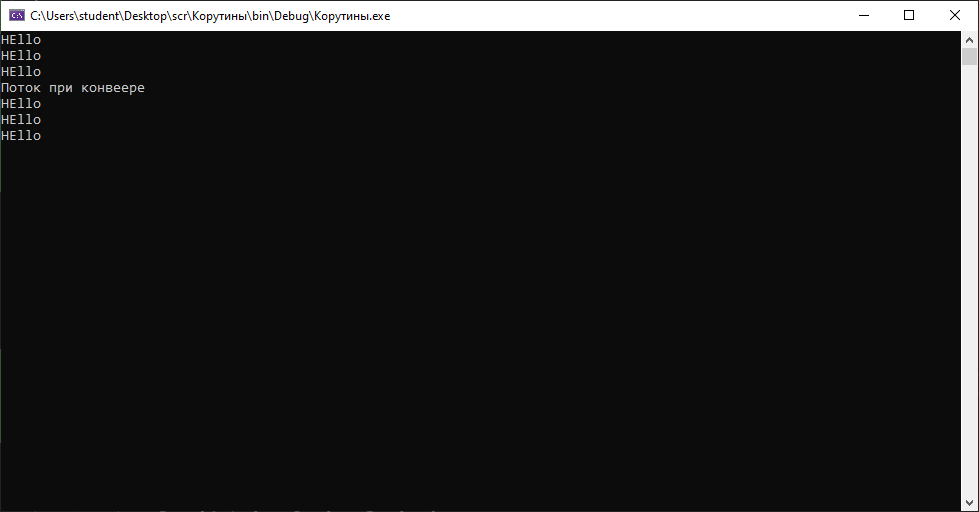
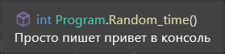
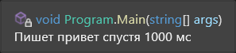

# Показывает как работают корутины
**Автор:** Кассыга с.о., группа И-43 
## Как запустить корутины
1. Открыть файл src/Коммиты.sln в SharpDevelop или Visual Studio 
2. Нажать F5 
3. Появятся окна
## Скриншоты 
### Скриншот 1: Вход 
  
   
  
