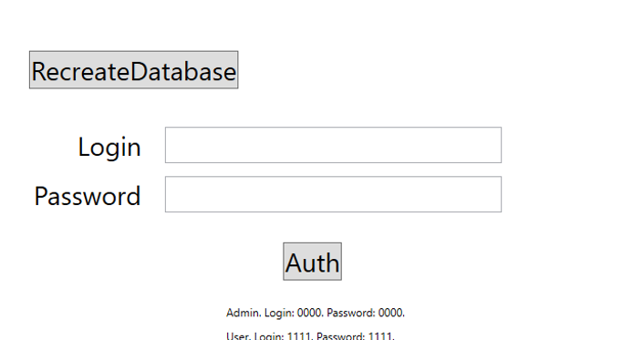
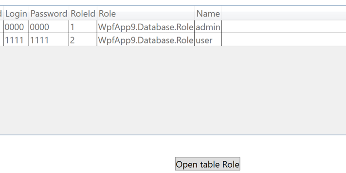
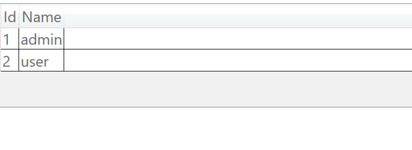

# Система заказов компании «Обувь-Маг» 
**Автор:** Кассыга с.о., группа И-43 
## Что делает программа - Смотрит роли в бд и их историю входа
## Как запустить 
1. Открыть файл src/Lab7.sln в SharpDevelop или Visual Studio 
2. Нажать F5 
3. Появятся окна
## Скриншоты 
### Скриншот 1: Вход 
  
### Скриншот 2: Листинг ролей в бд
  
### Скриншот 3: История входа
 
